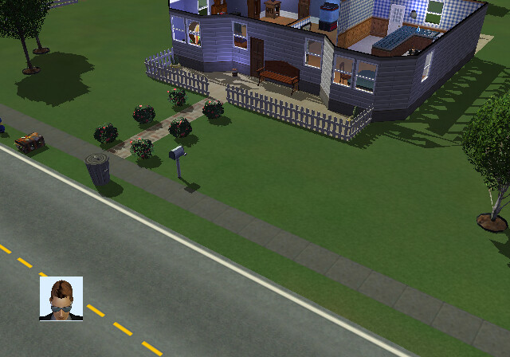
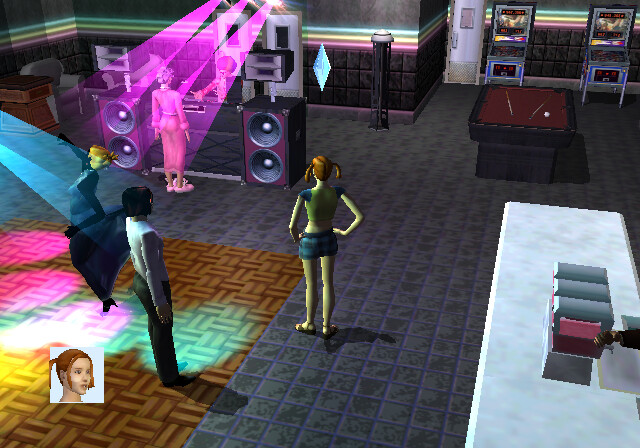

<div align="center">

# House Fire

### A Console Sims Game Engine

**The Sims Bustin' Out** first, then The Sims, The Urbz, The Sims 2, Pets and Castaway

[](LICENSE)


*The GameCube and Wii Sims games, running natively on PC and ARM handhelds from your own disc.*

 

<sub>The Sims Bustin' Out's home lot and club, simulated and drawn by House Fire's own engine and Vulkan renderer.</sub>

</div>

---

## What House Fire is

House Fire is a **new, native engine** for the console Sims games built on Edge of Reality and
Maxis's EOR engine. It is written in Rust from the ground up. **It is not an emulator and not a
recompilation**: none of the games' executable code runs.

What makes these games *the Sims* lives on the disc: every object, every interaction and every
Sim's behaviour is a **SimAntics script** (BHAV). House Fire reads those scripts from your disc
and runs them with its own interpreter. The simulation, routing, autonomy, motives, animation and
rendering around them are written anew. So the game logic is the games' own, while the engine is
clean, fast and portable.

| Game | Year | Disc ID | Engine |
|---|---|---|---|
| **The Sims Bustin' Out** | 2003 | `G4ME69` | EOR Engine v2.0 |
| The Sims | 2003 | `GCIE69` | EOR Engine v2.0 |
| The Urbz: Sims in the City | 2004 | `GUBE69` | EOR/Maxis Engine v3.0 |
| The Sims 2 | 2005 | `G4ZE69` | EOR/Maxis Engine v3.0 |
| The Sims 2: Pets | 2006 | `G4OE69` | EOR/Maxis Engine v3.0 |
| The Sims 2: Castaway (Wii) | 2007 | `R42E69` | EOR/Maxis Engine v3.0 |

## Goals

- **Native, everywhere.** A PC program with no emulator in between, aimed at low-end hardware
  too, down to ARM handhelds with small Mali GPUs.
- **Optimized as it's written.** The original's results are the answer key, its methods are
  not. Skinning and lighting move to the GPU, models and textures are converted once at load,
  and nothing is recomputed each frame that can be done once.
- **Exactly the same simulation.** The simulation is deterministic to the bit and checked step
  by step against the original game (see below).
- **Built for multiplayer.** Nothing of it is built yet, but the engine is shaped for it: the
  simulation is a deterministic state machine driven by player commands, kept apart from the
  presentation, and its whole state serializes for a joining player.

## Status

> House Fire is early. The simulation runs; the game around it is not playable yet.

- **Every disc reads.** Readers cover IFF and its chunks, `.arc` archives, quick data, models,
  textures and animations, checked by reading every file on every disc.
- **The interpreter and simulation match the original.** On Bustin' Out's home lot (Mom's
  house) and the club, a native run replays recorded play with no step of any Sim's or object's
  script stack different from the original's.
- **The renderer draws lots** with Sims, objects, lighting and shadows (above). About 97.5% of
  each frame's pixels come within 4 levels of the original's frame.
- **Next:** the native simulation driving itself instead of following a recording, then the
  presentation: animation, sound, menus, Create-A-Sim, saves and the story mode.

### How "the same" is checked

The reference is a recompiled build of Bustin' Out that runs the original code exactly and
replays exactly. It logs every step of the original's script interpreter. House Fire is held
to it in two ways:

- **`lockstep`** runs House Fire's interpreter beside the log, step for step, and stops at the
  first difference.
- **`replay`** runs the whole lot natively over the log's ticks and reports how much it still
  had to take from the log. Zero is a fully native run.

The method is in [`docs/interpreter.md`](docs/interpreter.md), "Checked against the original".

## Building

Rust (stable). The simulation crate has no outside dependencies; the renderer
(`engine/render`) uses `ash` (Vulkan), `png` and `winit`.

```sh
cargo build --release --manifest-path engine/Cargo.toml
cargo test  --release --manifest-path engine/Cargo.toml      # the rules
HOUSEFIRE_BUSTIN_ISO=/path/to/G4ME69.iso \
cargo test  --release --manifest-path engine/Cargo.toml      # ...and every script and lot on your disc
engine/target/release/lockstep LOG G4ME69.iso                # the native interpreter against a log
engine/target/release/replay   LOG G4ME69.iso [--card CARD]  # the lot run natively over the log's ticks
```

You need **your own disc image** of the game. House Fire ships none of the games' files.

## Tools

Python 3 scripts for looking inside the discs. `.rvz` images are read through decomp-toolkit
(`DTK=/path/to/dtk`); `.iso` directly.

```sh
tools/survey.py IMAGE...             # IFF chunk types on each disc, and where they are
tools/check_chunks.py IMAGE...       # read every chunk the engine uses; non-zero exit on a failure
tools/bhav_text.py [--dump] IMAGE... # check every script; --dump writes them as text to work/scripts/
tools/quickdata.py IMAGE [ENTRY]     # the tables in each quick data entry (quickdat.arc)
tools/objects.py check IMAGE         # object definitions in quick data
tools/interactions.py check|trees IMAGE  # interaction tables in quick data
tools/dispatch.py IMAGE...           # the opcodes each game's interpreter accepts
tools/ngh.py IMAGE [--dump]          # the neighbourhood file the lots come from
tools/lot.py IMAGE                   # the lots: chunk tables and object types
tools/objm.py IMAGE                  # each lot's objects
tools/tree_log.py LOG IMAGE          # a log of the original's interpreter: its trees, its steps
tools/locals_check.py IMAGE [LOG]    # scripts that read a local before writing it
tools/capped.sh CMD...               # run CMD with at most 2 GB and no swap
```

Libraries: `tools/disc.py` (disc images), `tools/arc.py` (`.arc` archives), `tools/iff.py`
(Maxis IFF 2.5), `tools/chunks.py` (chunk types), `tools/primitives.py` (the primitives' names
and each game's opcodes), `tools/ppc.py` (reading switches in the executables).

## Documentation

| Doc | About |
|---|---|
| [`docs/plan.md`](docs/plan.md) | How the engine is built: the order, multiplayer, optimization, deliberate differences |
| [`docs/survey.md`](docs/survey.md) | What each disc holds |
| [`docs/simulation.md`](docs/simulation.md) | The simulation: ticks, autonomy, routing, motives |
| [`docs/interpreter.md`](docs/interpreter.md), [`docs/primitives.md`](docs/primitives.md) | The SimAntics interpreter and its primitives |
| [`docs/objects.md`](docs/objects.md), [`docs/lots.md`](docs/lots.md) | The scripts' variables, and where the world comes from |
| [`docs/assets.md`](docs/assets.md) | Models, textures, animation and lighting |
| [`docs/open.md`](docs/open.md) | Open problems and what was tried |

## Contributing

Contributions are welcome. The open problems in [`docs/open.md`](docs/open.md) are the best
place to start; each lists what was measured and what was already tried.

The rules:
- **No game code or data in the repository.** Discs are the player's own and are read in
  place; anything extracted goes to `work/` (ignored). Function names and addresses, and
  descriptions of formats, may be written down. Code, scripts, strings and assets from the
  games may not.
- The engine's internals are its own design, never a copy of the original's memory layouts.
- Commit messages are one line.

## Legal

House Fire is an independent, unofficial project. It is not affiliated with or endorsed by
Electronic Arts, Maxis or Edge of Reality. *The Sims*, *The Urbz* and related titles are
trademarks of Electronic Arts Inc. House Fire contains no code, art, sound or other data from
the games: you need your own legally obtained copy to play.

House Fire is free software: you can redistribute it and/or modify it under the terms of the
**GNU General Public License, version 3 or (at your option) any later version**. See
[`LICENSE`](LICENSE). Copyright © 2026 daftblazer.
